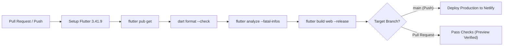

# Ahmad Alhomsy | Software Engineer & Flutter Developer

[](https://github.com/ahmadhomsy/portfolio/actions/workflows/deploy-netlify.yml)
[](https://flutter.dev)
[](https://dart.dev)
[](https://ahmad-alhomsy-portfolio.netlify.app)
[](#license)

Personal portfolio web application engineered with **Flutter Web**, demonstrating production-grade software architecture, responsive UI design, reactive state management, and automated continuous delivery.

[**Explore Live Website**](https://ahmad-alhomsy-portfolio.netlify.app) &nbsp;&bull;&nbsp;
[**GitHub Profile**](https://github.com/ahmadhomsy) &nbsp;&bull;&nbsp;
[**LinkedIn Profile**](https://linkedin.com/in/ahmad-alhomsy963)

---

## Website Preview

<p align="center">
  
  
</p>

*Desktop (1440&times;1000) and Mobile (390&times;844) production views running on Flutter Web CanvasKit.*

---

## Overview & Purpose

This repository houses the personal portfolio single-page application (SPA) of **Ahmad Alhomsy**, a Mobile Software Engineer specializing in cross-platform application development with Flutter and Dart.

The application serves as both an interactive résumé and a tangible demonstration of frontend engineering best practices:
- **Clean Architecture & Decoupling:** Structured into independent core and feature layers to maximize testability and maintainability.
- **Production CI/CD Automation:** Every Pull Request undergoes automated static analysis, code formatting verification, and production compilation checks before deployment.
- **Responsive Across Form Factors:** Designed from the ground up to provide optimal viewing experiences across desktop monitors, tablets, and smartphones.

---

## Key Features

- **Responsive Multi-Device Layout:** Adaptive layouts featuring distinct desktop and mobile presentations, including collapsed navigation drawers and responsive typography.
- **Fluid Micro-Interactions & Animations:** Declarative entrance transitions and hover states orchestrated via `flutter_animate` and custom typing effects.
- **Declarative SPA Navigation:** Configured with `go_router` supporting deep linking, clean URLs, and client-side route fallback handling via Netlify edge redirects (`_redirects` and `netlify.toml`).
- **Reactive State Architecture:** Predictable state flow powered by BLoC and Cubit patterns (`flutter_bloc`), separating business logic from UI widgets.
- **Service Locator & Dependency Injection:** Loose coupling facilitated through `get_it`, allowing modular registration of services and helpers.
- **SEO & Social Open Graph Integration:** Rich Open Graph and Twitter Card metadata embedded for search engine discoverability and social sharing previews.

---

## Featured Projects

The portfolio showcases key mobile applications demonstrating architecture patterns, REST API integration, and real-world workflows:

| Project | Description | Tech Stack | Repository |
| :--- | :--- | :--- | :---: |
| **Sham Booking** | Hotel and accommodation booking platform featuring comprehensive search filters, room discovery, and booking management. | Flutter, Dart, Clean Architecture, BLoC, REST APIs | [View Source](https://github.com/ahmadhomsy/sham-booking) |
| **Daily Done** | Productivity and task execution manager implementing clean domain architecture, local persistence, and stateful task tracking. | Flutter, Dart, Clean Architecture, BLoC | [View Source](https://github.com/ahmadhomsy/daily_done_app_flutter_clean_code_architecture) |
| **Weather App** | Weather forecasting application delivering real-time atmospheric updates, dynamic weather graphics, and geolocation forecasts. | Flutter, Dart, Clean Architecture, REST APIs | [View Source](https://github.com/ahmadhomsy/weather_app_flutter_clean_code_architecture) |
| **Quiz App** | Interactive trivia mobile application featuring timed question rounds, score computation, and dynamic state evaluation. | Flutter, Dart, State Management, Custom UI | [View Source](https://github.com/ahmadhomsy/Quiz-App) |

### Additional Projects & Active Development

- **BMI Calculator:** Health and fitness metric evaluation tool providing dynamic BMI classification and visual health metrics.
- **Simple Chat App:** Real-time messaging mobile application (*currently in active development*).

---

## Technology Stack

| Category | Technologies |
| :--- | :--- |
| **Framework & Language** | Flutter `3.41.9` (Web / CanvasKit & HTML renderers), Dart SDK `^3.11.0` |
| **State Management** | `flutter_bloc` `^9.1.1`, `bloc` `^9.0.1` |
| **Architecture & DI** | Feature-First Clean Architecture, `get_it` `^9.2.1` Service Locator |
| **Routing & Navigation** | `go_router` `^17.1.0` with client-side SPA redirects |
| **UI, Styling & Animation**| `flutter_animate` `^4.3.0`, Material Design 3, `google_fonts` `^8.0.2` |
| **Iconography** | `lucide_icons` `^0.257.0`, `font_awesome_flutter` `^10.9.1` |
| **System & Utilities** | `url_launcher` `^6.3.2` |
| **Hosting & CI/CD** | GitHub Actions, Netlify CLI `^23.12.0`, Netlify Global CDN |

---

## Project Structure

The project follows a modular, feature-first folder organization:

```text
lib/
├── core/
│   ├── helpers/         # Utility classes, URL launcher service, and platform helpers
│   ├── theme/           # App colors, typography definitions, and ThemeData configuration
│   └── widget/          # Reusable shared components, responsive wrappers, and section headers
├── features/
│   ├── home/            # Main portfolio presentation layer
│   │   ├── data/        # Static content models, section data, and experience records
│   │   ├── logic/       # Cubits and state management controllers
│   │   └── presentation/
│   │       ├── pages/   # Primary HomeScreen entry point
│   │       └── widget/  # Section widgets (Hero, About, Projects, Experience, Skills, Contact)
│   └── project/         # Dedicated project detail showcases
│       ├── data/        # Project model definitions and portfolio data fixtures
│       ├── logic/       # Project state cubits
│       └── presentation/# Project preview cards and detail views
├── main.dart            # Application entry point and router initialization
└── service_locator.dart # GetIt dependency injection registry
```

---

## Getting Started

### Prerequisites

- [Flutter SDK](https://docs.flutter.dev/get-started/install) pinned to `3.41.9` (Channel `stable`)
- [Dart SDK](https://dart.dev/get-dart) `^3.11.0`
- [Google Chrome](https://www.google.com/chrome/) for local web execution and debugging

### Local Installation

1. **Clone the repository:**
   ```bash
   git clone https://github.com/ahmadhomsy/portfolio.git
   cd portfolio
   ```

2. **Install project dependencies:**
   ```bash
   flutter pub get
   ```

3. **Launch local development server:**
   ```bash
   flutter run -d chrome
   ```

4. **Run static analysis & code formatting:**
   ```bash
   dart format --output=none --set-exit-if-changed .
   flutter analyze --fatal-infos
   ```

5. **Generate a production web release build:**
   ```bash
   flutter build web --release
   ```
   The compiled web bundle will be output to `build/web/`.

---

## CI/CD Pipeline & Quality Assurance

Continuous integration and automated delivery are orchestrated via GitHub Actions and Netlify:



- **Workflow Definition:** [`.github/workflows/deploy-netlify.yml`](.github/workflows/deploy-netlify.yml)
- **Quality Gates:** Every commit and PR triggers automated checks ensuring zero code style discrepancies (`dart format`), zero static analysis warnings or infos (`flutter analyze --fatal-infos`), and clean release compilation (`flutter build web --release`).
- **Production Deployment:** Merging or pushing to `main` automatically deploys the compiled `build/web` distribution to Netlify edge nodes using pinned `netlify-cli`.
- **Testing Strategy:** The default starter template tests have been archived from the gating workflow; dedicated widget and unit test suites reflecting the portfolio's architecture are currently scheduled for subsequent engineering milestones.

---

## License

Copyright &copy; 2026 Ahmad Alhomsy. All rights reserved.

The source code and portfolio assets are proprietary. Unauthorized redistribution or commercial duplication without prior written permission is prohibited.

---

## Contact

- **Ahmad Alhomsy** &mdash; Mobile Software Engineer
- **Website:** [ahmad-alhomsy-portfolio.netlify.app](https://ahmad-alhomsy-portfolio.netlify.app)
- **GitHub:** [@ahmadhomsy](https://github.com/ahmadhomsy)
- **LinkedIn:** [Ahmad Alhomsy](https://linkedin.com/in/ahmad-alhomsy963)
