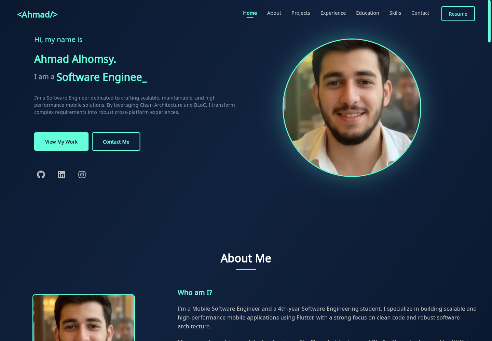
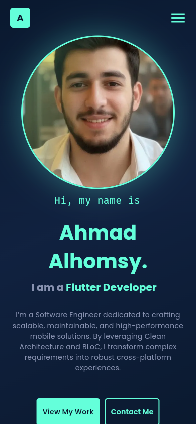
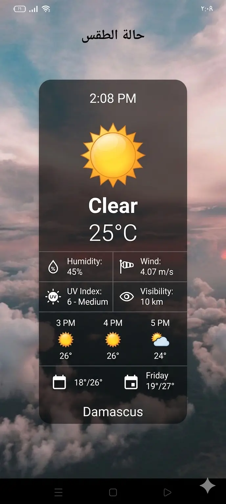
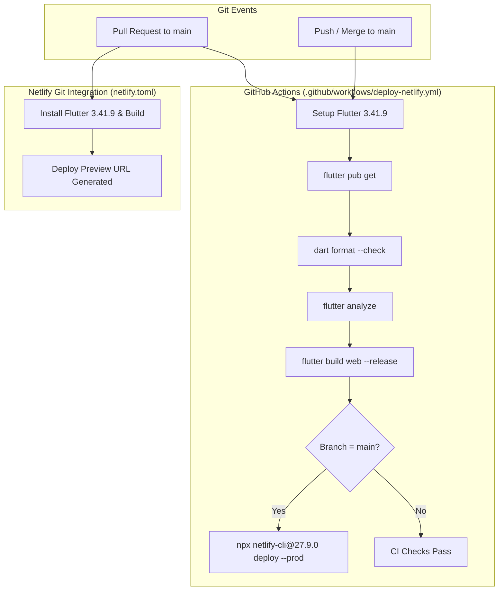

# Ahmad Alhomsy | Software Engineer & Flutter Developer

[](https://github.com/ahmadhomsy/portfolio/actions/workflows/deploy-netlify.yml)
[](https://flutter.dev)
[](https://dart.dev)
[](https://ahmad-alhomsy-portfolio.netlify.app)

Personal portfolio web application engineered with **Flutter Web**, demonstrating structured feature-first architecture, responsive UI design, reactive state management, and automated continuous delivery.

[**Explore Live Website**](https://ahmad-alhomsy-portfolio.netlify.app) &nbsp;&bull;&nbsp;
[**GitHub Profile**](https://github.com/ahmadhomsy) &nbsp;&bull;&nbsp;
[**LinkedIn Profile**](https://linkedin.com/in/ahmad-alhomsy963)

---

## Website Preview

<p align="center">
  
  
</p>

*Desktop (1440&times;1000) and Mobile (390&times;844) production views running on Flutter Web CanvasKit.*

---

## Overview & Purpose

This repository houses the personal portfolio single-page application (SPA) of **Ahmad Alhomsy**, a Mobile Software Engineer specializing in cross-platform application development with Flutter and Dart.

The application serves as both an interactive résumé and a demonstration of software engineering practices:
- **Feature-First Architecture:** Organized into modular feature packages and core shared services.
- **Automated CI/CD:** Every Pull Request undergoes automated static analysis, code formatting verification, and release compilation before deployment.
- **Responsive Across Devices:** Designed from the ground up to provide optimal viewing experiences across desktop, tablet, and mobile breakpoints.

---

## Key Features

- **Responsive Multi-Device Layout:** Adaptive layouts featuring distinct desktop and mobile presentations, including collapsed navigation drawers and responsive typography.
- **Fluid Micro-Interactions & Animations:** Declarative entrance transitions and hover states orchestrated via `flutter_animate` and dynamic typing effects powered by `animated_text_kit`.
- **Declarative Routing:** Configured with `go_router` in `lib/core/helpers/go_router_helper.dart` supporting deep linking, clean URLs, and client-side route fallback handling via Netlify redirects defined in `netlify.toml`.
- **Reactive State Management:** Predictable state flow powered by BLoC and Cubit patterns (`flutter_bloc`), separating business logic from UI widgets.
- **Service Locator & Dependency Injection:** Loose coupling facilitated through `get_it`, initialized in `lib/injection_container.dart` for modular registration of services and helpers.
- **SEO & Social Open Graph Integration:** Rich Open Graph and Twitter Card metadata embedded in `web/index.html` for discoverability and link previews.

---

## Featured Projects

<table>
  <tr>
    <td width="50%" valign="top">
      
      <h3>Sham Booking</h3>
      <p>Hotel and accommodation booking platform featuring comprehensive search filters, room discovery, and booking management.</p>
      <p><strong>Technologies:</strong> Flutter, Dart, Clean Architecture, BLoC, REST APIs</p>
      <p><a href="https://github.com/ahmadhomsy/sham-booking">View Source Repository &rarr;</a></p>
    </td>
    <td width="50%" valign="top">
      
      <h3>Daily Done</h3>
      <p>Productivity and task execution manager implementing clean domain architecture, local persistence, and stateful task tracking.</p>
      <p><strong>Technologies:</strong> Flutter, Dart, Clean Architecture, BLoC</p>
      <p><a href="https://github.com/ahmadhomsy/daily_done_app_flutter_clean_code_architecture">View Source Repository &rarr;</a></p>
    </td>
  </tr>
  <tr>
    <td width="50%" valign="top">
      
      <h3>Weather App</h3>
      <p>Weather forecasting application delivering real-time atmospheric updates, dynamic weather graphics, and geolocation forecasts.</p>
      <p><strong>Technologies:</strong> Flutter, Dart, Clean Architecture, REST APIs</p>
      <p><a href="https://github.com/ahmadhomsy/weather_app_flutter_clean_code_architecture">View Source Repository &rarr;</a></p>
    </td>
    <td width="50%" valign="top">
      
      <h3>Quiz App</h3>
      <p>Interactive trivia mobile application featuring timed question rounds, score computation, and dynamic state evaluation.</p>
      <p><strong>Technologies:</strong> Flutter, Dart, State Management, Custom UI</p>
      <p><a href="https://github.com/ahmadhomsy/Quiz-App">View Source Repository &rarr;</a></p>
    </td>
  </tr>
</table>

### Additional Projects & Active Development

- **BMI Calculator:** Health and fitness metric evaluation tool providing dynamic BMI classification and visual health metrics.
- **Simple Chat App:** Real-time messaging mobile application (*currently in active development*).

---

## Technology Stack

| Category | Technology | Version / Constraint |
| :--- | :--- | :--- |
| **Framework** | Flutter | `3.41.9` (pinned in CI/CD) |
| **Language** | Dart SDK | `>=3.0.0 <4.0.0` (as defined in `pubspec.yaml`) |
| **State Management** | `bloc`<br>`flutter_bloc` | `^9.2.0`<br>`^9.1.1` |
| **Service Locator** | `get_it` | `^9.2.1` |
| **Routing** | `go_router` | `^17.1.0` |
| **Animations & Typography** | `flutter_animate`<br>`animated_text_kit`<br>`google_fonts` | `^4.3.0`<br>`^4.2.2`<br>`^6.1.0` |
| **Iconography** | `lucide_icons`<br>`font_awesome_flutter` | `^0.257.0`<br>`^10.6.0` |
| **Platform Services** | `url_launcher` | `^6.2.2` |
| **CI / Deployment Tooling** | Netlify CLI | `27.9.0` (invoked via `npx` in CI/CD workflow) |

---

## Project Structure

The codebase is organized following a feature-first architectural pattern:

```text
lib/
├── app.dart
├── main.dart
├── injection_container.dart
├── core/
│   ├── bootstrap/
│   ├── enums/
│   ├── extension/
│   ├── helpers/
│   ├── theme/
│   └── widget/
└── features/
    ├── home/
    │   ├── cubit/
    │   ├── data/
    │   └── presentation/
    │       ├── pages/
    │       └── widget/
    └── project/
        ├── data/
        └── presentation/
            ├── pages/
            └── widget/
```

- **`lib/app.dart` & `lib/main.dart`:** Application root widget, theme initialization, and entry point.
- **`lib/injection_container.dart`:** Central service locator configuring `GetIt` dependencies across core services and feature cubits.
- **`lib/core/`:** Shared foundations including bootstrap logic, enums, extensions, layout helpers (`Responsive`), router configuration (`go_router_helper.dart`), app theme, and reusable widgets.
- **`lib/features/home/`:** Main portfolio view partitioned into `cubit` (hover and navigation state), `data` (section definitions and text models), and `presentation` (screen layout and section components).
- **`lib/features/project/`:** Project detail presentation models, preview cards, and responsive project screens.

---

## Getting Started

### Prerequisites

- [Flutter SDK](https://docs.flutter.dev/get-started/install) `3.41.9`
- [Dart SDK](https://dart.dev/get-dart) within `>=3.0.0 <4.0.0`
- [Google Chrome](https://www.google.com/chrome/) for local web execution

### Local Installation

1. **Clone the repository:**
   ```bash
   git clone https://github.com/ahmadhomsy/portfolio.git
   cd portfolio
   ```

2. **Install project dependencies:**
   ```bash
   flutter pub get
   ```

3. **Launch local development server:**
   ```bash
   flutter run -d chrome
   ```

4. **Run static analysis & code formatting:**
   ```bash
   dart format --output=none --set-exit-if-changed .
   flutter analyze
   ```

5. **Generate a production web release build:**
   ```bash
   flutter build web --release
   ```
   The compiled web bundle will be output to `build/web/`.

---

## CI/CD Pipeline & Quality Assurance

Continuous integration and automated delivery are orchestrated across GitHub Actions and Netlify:



- **GitHub Actions Workflow:** [`.github/workflows/deploy-netlify.yml`](.github/workflows/deploy-netlify.yml) executes on every Pull Request targeting `main` and on direct pushes to `main`. It enforces strict quality gates:
  ```bash
  flutter pub get
  dart format --output=none --set-exit-if-changed .
  flutter analyze
  flutter build web --release
  ```
- **Production Deployment:** On merge to `main`, GitHub Actions deploys the production bundle to Netlify using pinned `netlify-cli@27.9.0`:
  ```bash
  npx --yes netlify-cli@27.9.0 deploy --prod --dir=build/web --site "$NETLIFY_SITE_ID"
  ```
- **Netlify Deploy Previews:** Netlify independently builds and publishes ephemeral Deploy Previews for incoming pull requests via its repository integration using `netlify.toml`.
- **SPA Routing:** Client-side SPA routing fallback is handled by the redirect rule in `netlify.toml` (`/*` &rarr; `/index.html` with status `200`).
- **Testing Status:** The repository currently contains the default Flutter counter smoke test, which does not represent the portfolio application. Automated widget and unit testing is not yet enforced in the CI workflow.

---

## Contact

- **Ahmad Alhomsy** &mdash; Mobile Software Engineer
- **Website:** [ahmad-alhomsy-portfolio.netlify.app](https://ahmad-alhomsy-portfolio.netlify.app)
- **GitHub:** [@ahmadhomsy](https://github.com/ahmadhomsy)
- **LinkedIn:** [Ahmad Alhomsy](https://linkedin.com/in/ahmad-alhomsy963)
